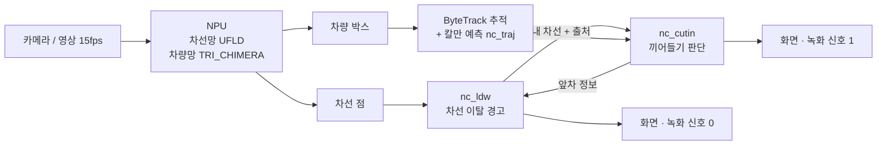

# 차선 이탈 경고 + 끼어들기 예측: 최종 알고리즘 (11/06)

NextChip Apache6 보드에서 한 대의 앞 카메라 영상으로 **차선 이탈**과 **앞 끼어들기**를 경고하는 프로그램의 현재 동작을 정리한다.
숫자는 모두 현재 코드의 기본값이고, 대부분 보드에서 환경변수로 바꿀 수 있다 (부록 A).

---

## 1. 전체 흐름



| 단계 | 하는 일 | 파일 |
|---|---|---|
| 차선 이탈 경고 | 차선 두 선 → 내 차 위치(m) → 경고 | `ldw/nc_ldw.c` |
| 내 차선 제공 | 끼어들기에 내 차선 + **출처**(실제/유지/앞차/가상) | `ldw/nc_ldw.c` |
| 추적·예측 | 차량별 칼만 필터, 1초 뒤 위치 | `cnn/core/nc_traj.c` (준이) |
| 끼어들기 판단 | 차선 안 비율 u로 들어오는지 판단 → 경고 | `cnn/core/nc_cutin.c` |

---

## 2. 차선 이탈 경고 (LDW)

### 2.1 차선 → 미터

1. 차선망 결과 중 내 차선 두 선(1번, 2번)을 골라, 화면 아래쪽 45% 점만으로 직선 `x = a·y + b`를 맞춘다. 어긋남이 크면 버린다.
2. 기준 줄(화면 80% 높이)에서 두 선 사이를 **3.5m**로 보고 1px이 몇 m인지 정한다.
3. 두 선이 만나는 **소실점**과 줄마다의 차선 폭(`폭 = k × (y − 소실점y)`)을 계속 배워 둔다 (평균).
4. 한 선만 보이면 배운 폭으로 반대쪽 선을 만든다.

### 2.2 내 차 위치

| 값 | 계산 |
|---|---|
| 차 가운데 | 카메라 열(화면 가운데) − 카메라 장착 위치(m) − **평소 위치 보정**(2.3) |
| 치우침 | 차 가운데 − 차선 가운데 (m, +: 오른쪽) |
| 선까지 거리 | 차 옆면(폭 1.85m의 절반)에서 각 선까지 (m) |
| 옆 속도 | 치우침 변화량, 평균(0.3) |
| TLC | 다가가는 쪽 선까지 거리 ÷ 옆 속도 |

### 2.3 평소 위치 보정 (새로 추가)

- **문제:** 휴대폰이 운전석 쪽에 달려 카메라가 차 가운데에 없으면, 차가 늘 한쪽으로 치우쳐 보인다. 그러면 그쪽 경고가 계속 난다 (야간 굽은 길 영상: 13번).
- **방법:** 운전자는 평균적으로 차선 가운데를 달린다. 그래서 안정 주행 중 치우침의 느린 평균(약 20초)을 카메라 치우침으로 본다.
  - 안정 주행 조건: 두 선이 다 보이고, 옆 속도 0.2m/s 미만, 선을 넘지 않음
- **적용:** 10초 이상 배운 뒤부터 쓴다.
  - **0.2m까지는 운전 습관으로 보고 남긴다.** 0.2m를 넘는 부분만 보정하고, 최대 0.6m까지만 보정한다.
  - 0.2m를 남기는 이유: 기본 영상의 운전자는 +0.21m에 붙어 달리는데, 이것까지 지우면 맞다고 확인한 실선 경고가 사라졌다.
- **실제 이탈은 그대로:** 이탈은 몇 초 안에 일어나고 학습은 20초 평균이라 지워지지 않는다. PC 시험에서 경고 시각이 가운데 카메라와 같았다.
- **옆 속도는 보정 전 치우침으로 계산한다.** 보정값이 바뀌는 순간 치우침이 0.2~0.4m 바뀌는데, 이것을 움직임으로 보면 옆 속도가 1m/s 넘게 튀어 TLC 오경보가 났다 (11/09 보드: px·도심·야간 굽은 길에서 1번씩, 고친 뒤 0).
- 장착 위치를 알면 `LDW_CAM_OFFSET`으로 직접 넣는다.

### 2.4 경고 기준

한쪽(왼/오)마다 아래 중 하나가 **2프레임 연속**이면 경고한다.

| 기준 | 조건 |
|---|---|
| A. 가까움 | 그쪽 선까지 **0.5m 미만**이고, 반대쪽으로 움직이는 중이 아님 |
| B. 곧 넘음 | 그쪽으로 0.10m/s 넘게 움직이고, TLC < **0.8 + 지연 + 0.7초** (지연 35ms → 1.54초), 선까지 1.5m 미만 |

- **끄기:** 조건이 없어지면 끈다. 단 켜진 뒤 최소 1초는 유지한다.
- **경고하지 않는 경우:**
  - 그쪽 방향지시등이 켜져 있을 때
  - 차선 번호가 바뀐 프레임 (내가 선을 넘어 차선이 바뀜)
  - 차선이 0.5초 넘게 없을 때 (INVALID)
  - 모델 SKIP 모드일 때
- **세기:** 최근 프레임 투표(평균 0.15)로 그 선이 점선이면 **약한 경고**(노란 얇은 테두리), 실선이거나 모르면 **강한 경고**(빨간 두꺼운 테두리).
- **녹화:** 경고가 꺼짐 → 켜짐일 때만 `nc_rec_trigger(0)`.

### 2.5 카메라 안내 (새로 추가)

- 시작 후 10초 동안 차선이 한 번도 안 잡히면 안내를 출력한다: `"no lane for 10 s: check the camera - horizon at about 40-50% ..."`
- 배운 소실점이 화면 70%보다 아래면 안내를 출력한다: `"camera tilted down?"` (62~67%인 test3·px·도심은 정상 동작해서 70%로 정함)
- 근거: 지평선이 화면 70% 높이인 영상 3개는 선명한 차선도 못 잡았고, 같은 영상의 아래쪽을 확대하니 잡았다.
- 시험 영상의 구도가 다르면 `FEED_VF="crop=1067:600:426:480"`처럼 영상 공급 단계에서 잘라 넣을 수 있다.

---

## 3. 끼어들기에 주는 내 차선 (출처)

LDW는 차선이 안 보이면 쉰다. 끼어들기는 차선이 잠깐 안 보여도 계속 판단해야 해서, 아래 순서로 차선을 만들어 준다.

| 순서 | 출처 | 언제 | 만드는 법 |
|---|---|---|---|
| 1 | `detected` / `one-side` | 선이 보임 (0.2초 안) | 실제 선 |
| 2 | `held` | 0.2~1.0초 안 보임 | 마지막 선을 내 옆 속도 × 시간만큼 옮김 (0.2m/s 넘는 부분만, 최대 1m/s) |
| 3 | `lead` | 그 뒤, 앞차를 1초 이상 따라감 | 앞차 기준 (3.1) |
| 4 | `virtual` | 그 뒤 | 배운 소실점 + 평소 차선 가운데 + 줄마다 폭으로 3.5m 통로 |
| – | `none` | 도로 모양을 한 번도 못 배움 | 판단 안 함 |

- 원래 함수 `nc_ldw_get_ego_lane()`은 실제 선(1번)만 준다. 끼어들기는 `nc_ldw_get_ego_lane_src()`를 쓴다.
- 화면: 선이 안 보이면 2~4번 차선을 하늘색 선으로 그리고 `LDW: no lane (cut-in: ... lane)`을 표시한다.

### 3.1 앞차 기준 차선 (`lead`)

| 단계 | 규칙 |
|---|---|
| 고르기 | 다음 조건을 모두 만족하는 차 중 가장 가까운 차:<br/>- 바닥 줄이 소실점에서 기준 줄 거리의 **절반 이상** 아래 (카메라 화각과 무관한 거리 조건)<br/>- 차선 안 u 0.25~0.75 (선이 없을 때는 0.4~0.6)<br/>- 끼어들기 경고·후보가 아님 |
| 배우기 | 선이 보일 때만, 앞차가 차선 가운데에서 떨어진 거리(m)와 박스 폭 ÷ 차선 폭을 평균(0.1)으로 배움. 5번 뒤부터 사용 |
| 믿기 | 박스 폭 ÷ 차선 폭이 **0.40~0.85**일 때만 배운 값을 씀 (보드 실측 0.49~0.74) |
| 만들기 | 앞차 위치·폭에서 차선 가운데와 폭을 거꾸로 계산. 소실점을 지나는 통로로 그림 |
| 못 배웠을 때 | 차종 폭(승용 1.8m, 버스·트럭 2.5m)으로 **폭만** 고치고, 가운데는 가상 차선 |
| 안 쓰는 경우 | 만든 차선 폭이 배운 폭의 0.75~1.3배를 벗어남 |
| 버리기 | 0.5초 안 보임 / 박스 폭이 한 번에 30% 넘게 바뀜 / 선이 없을 때 가상 차선 기준 u 0.1~0.9 밖 (앞차가 차선 바꿈) |
| 차 정보 | `nc_cutin_eval()`이 차마다 `nc_ldw_feed_vehicle()`로 넘김 (`wayland_npu_app.c` 변경 없음) |

---

## 4. 끼어들기 예측

### 4.1 핵심 개념: 차선 안 비율 u

```
u = (x − 왼쪽 선 x) / (오른쪽 선 x − 왼쪽 선 x)        (같은 화면 줄에서)
u = 0 왼쪽 선, 0.5 가운데, 1 오른쪽 선, 0~1 = 내 차선 안
```
- 굽은 길이나 내 차의 방향 변화는 차와 차선을 같이 움직이므로 u에서 상쇄된다. **실제 옆 움직임만 u를 바꾼다.**
- 차의 기준점은 **박스 아래 가운데**(바퀴가 땅에 닿는 곳)이다.

### 4.2 예측

1. ByteTrack 추적 번호마다 칼만 필터(등속 모델)로 박스 가운데 위치·속도를 추정한다 (`nc_traj`).
2. **1초 뒤 바퀴 위치** = 1초 뒤 박스 가운데 + **1초 뒤 박스 높이**의 절반.
   - 박스 높이가 커지는 속도는 추적 번호마다 150ms 간격으로 잰다.
   - 지금 높이를 쓰면 가까워지는 차를 먼 줄에서 판단해서 놓쳤다. 고친 문제다.
3. 지금 위치와 1초 뒤 위치를 각각 그 줄의 내 차선으로 u로 바꾼다 (`u_now`, `u_fut`).

### 4.3 후보 (한 프레임)

아래 **모두**를 만족하면 그 프레임의 후보다.

| 조건 | 내용 |
|---|---|
| ① 들어옴 | `u_now`가 차선 밖(<0 또는 >1)<br/>**또는** (앞차·가상 차선에서만) 들어오는 움직임 규칙: 차선 옆 0.15 안에 있고 가운데 쪽으로 0.25 이상 움직임 |
| ② 안으로 | `u_fut`가 0.10~0.90 (차선 안쪽으로 여유 있게) |
| ③ 빨리 멀어지는 차 아님 (새로 추가) | 1초 뒤 바퀴 줄의 차선 폭이 지금 줄의 **0.6배 미만**이 아니고, 1초 뒤 박스가 지금의 **0.5배 미만**도 아님. 한 번 걸리면 1초 동안 유지 |

③의 이유:
- 빨리 멀어지는 차는 화면에서 소실점 쪽으로 모이면서 "안으로 들어오는" 것처럼 예측된다. 그런데 간격이 벌어지는 중이라 위험하지 않다.
- 보드 실측: 도심 영상의 출발하는 옆 SUV는 0.46~0.65, test3의 진짜 끼어드는 차(추월하면서 끼어듦)는 0.84~0.91.

**판단하지 않는 경우**
- 그 줄의 차선 폭이 200px 미만 (먼 차, 약 17m 넘게)
- 내 차선이 없음
- 차선 결과가 오래됨 (200ms와 3프레임 간격 중 긴 쪽)
- 내가 차선을 바꾼 직후 0.5초 (차선 가운데가 폭의 40% 넘게 튐, 실제 선일 때만 감지)

### 4.4 경고 켜기·끄기

| 단계 | 규칙 |
|---|---|
| 켜기 | 같은 추적 번호가 **100ms 이상, 최소 3프레임** 연속 후보 |
| 끄기 | 333ms 동안 후보가 아니고, 켜진 지 **1초** 이상 지남 |
| 중복 | 켜질 때 최근 3초 안에 같은 자리(박스 폭 이내)에서 켜졌던 차나 같은 추적 번호가 있으면 **같은 차로 보고 녹화 안 함** (트럭↔승용차 재인식, 같은 차가 다시 켜짐) |
| 녹화 | 새 차가 켜질 때 `nc_rec_trigger(1)` |
| 화면 | 노란 이중 박스 + `[번호]CUT-IN`, 아래 `CUT-IN WARNING`, 예측 선 |

시간 기준은 모두 ms이고, 화면에 보여준 프레임의 시각을 쓴다. 그래서 fps가 바뀌어도 동작이 같다 (앱은 약 15fps).

---

## 5. 검증

### 5.1 PC 가상 시험 (`share/pc_test/`)

| 시험 | 내용 | 결과 |
|---|---|---|
| `test_lanesrc.c` 33개 | 끼어듦(천천히·빠르게·가까워지며·멀어지며), 경고가 없어야 하는 경우(옆 차선 유지·흔들림·추월·앞차·빨리 멀어짐), 차선 1초 끊김 / 계속 없음, 도로 모양 변화, 내 차 치우침, 앞차 차선 변경 | 10·14fps 모두 통과. 30fps: 빨리 멀어지는 옆 차 1개 실패. 7fps: 가까워지며 끼어듦 2개 실패 |
| `test_center.c` | 카메라 −0.6m: 안정 주행 경고 13 → 1, 실제 이탈은 같은 시각 경고. 카메라 0, +0.2m: 변화 없음 | 통과 |

### 5.2 보드 (최종 빌드, 15fps)

| 영상 | 결과 |
|---|---|
| `test3_1080p.mkv` (가까이서 끼어듦) | 반복 3번 모두 1.1초쯤 경고, 녹화 3번 |
| `px_5915075.mp4` (천천히 끼어듦, 버스) | 3.7초 경고, 녹화 1번, 버스 오경보 없음 |
| 기본 영상 | 끼어들기 0. LDW 오른쪽 경고 유지 (평소 위치 보정이 지우지 않음) |
| test3 / px, 차선 끊음 | test3 3번 모두 (virtual). px 반복마다 held 또는 virtual로 경고 |
| 기본 영상, 차선 끊음 | 오경보 0 |
| `sc_night_curve.mp4` | LDW 13 → 11 (평소 위치 −0.58m 학습, 보정 −0.38~−0.58m) |
| `sc_city_lead.mp4` | 앞차 고르기·배우기 정상(박스 폭 0.58). **36.6초 오경보 1번 남음** (아래) |
| 야간 고속도로·주간 굽은 길 (아래쪽 확대본) | 차선 인식, 오경보 0 |

---

## 6. 한계

| 한계 | 내용 | 다음 할 일 |
|---|---|---|
| 도심 36.6초 오경보 | 정지 신호에서 출발하는 옆 SUV의 박스가 한 프레임에 30px 튀었고, 1초 예측이 이것을 차선 안으로 키움. 진짜 끼어들기(test3)도 비슷한 크기로 시작해 지금 정보로는 구별 못 함 | 내 차 속도(CAN)로 정지·저속 때 기준 바꾸기, 박스 흔들림 줄이기 |
| 카메라 각도 | 지평선이 화면 70% 높이면 차선을 못 잡음 | 장착 때 지평선 40~50% 높이 |
| 시작부터 차선 없음 | 안개 영상: 도로 모양을 못 배워 아무 판단 못 함 | 배운 값을 파일로 저장해 다음 실행에 쓰기 |
| 좁은 차선 | 3.5m보다 좁은 시골 차선에서 LDW 가까움 기준(0.5m)이 자주 걸림 | 차선 폭에 따라 여유 줄이기, `LDW_LANE_WIDTH` |
| 거리 기준 px 값 | 끼어들기 먼 차 제외(200px)는 카메라 화각에 따라 달라짐 | 앞차처럼 소실점 기준 비율로 바꾸기 |
| 낮은 fps | 7fps에서 가까워지며 끼어드는 차, 30fps에서 빨리 멀어지는 차 (PC) | 보드 15fps에서는 해당 없음 |
| 검증 양 | 실제 끼어들기 영상 2개, 왼쪽 끼어들기·정체 영상 없음 | 블랙박스 위치에서 직접 촬영 |
| 임시 함수 | 지연 35ms 고정, 녹화·모델 전환은 서영 임시 함수 | 서영 실제 파일로 다시 확인 |

---

## 부록 A. 환경변수 (다시 빌드 없이 보드에서)

| 환경변수 | 기본 | 의미 |
|---|---|---|
| `LDW_WARN_MARGIN` | 0.50 | 선까지 이 거리(m) 미만이면 경고 |
| `LDW_REACTION` / `LDW_TLC_MARGIN` | 0.8 / 0.7 | TLC 기준 = 반응 + 지연 + 여유 (초) |
| `LDW_TLC_MAX_DIST` / `LDW_MIN_VEL` | 1.5 / 0.10 | TLC 경고 최대 거리(m) / 최소 옆 속도(m/s) |
| `LDW_TRIGGER_FRAMES` / `LDW_HOLD` | 2 / 1.0 | 켜기 프레임 / 최소 표시(초) |
| `LDW_CAM_OFFSET` | 0 | 카메라 장착 위치(m, +: 오른쪽) |
| `LDW_LANE_WIDTH` | 3.5 | 차선 폭 가정(m) |
| `LDW_AUTO_CENTER` / `LDW_AUTO_CENTER_MAX` | 1 / 0.6 | 평소 위치 보정 / 최대(m) |
| `LDW_CAM_X` / `LDW_REF_Y` | 960 / 864 | 카메라 열 / 기준 줄(px) |
| `LDW_EGO_HOLD_S` | 1.0 | held 유지(초) |
| `LDW_EGO_LEAD` / `LDW_LEAD_MIN_S` | 1 / 1.0 | 앞차 기준 사용 / 따라가야 하는 시간 |
| `LDW_EGO_VIRTUAL` | 1 | 가상 차선 사용 |
| `LDW_DROP_AFTER_S`, `_EVERY_S`, `_LEN_S` | 끔 | **시험용** 차선 끊기 |
| `CUTIN_HORIZON_MS` | 1000 | 예측 시간 |
| `CUTIN_MARGIN` | 0.10 | 예측 위치 안쪽 여유 |
| `CUTIN_ON_MS` / `CUTIN_OFF_MS` / `CUTIN_MIN_ON_MS` | 100 / 333 / 1000 | 켜기 / 끄기 / 최소 표시 |
| `CUTIN_DUP_MS` | 3000 | 같은 차로 보는 시간 |
| `CUTIN_MIN_LANE_W` | 200 | 먼 차 제외(px) |
| `CUTIN_LANE_SRC` | 3 | 0 실제만 / 1 +held / 2 +lead / 3 +virtual |
| `CUTIN_LEAD_ON_MS` / `CUTIN_VIRT_ON_MS` / `CUTIN_VIRT_MARGIN` | 100 / 100 / 0.10 | 추정 차선일 때 |
| `CUTIN_EST_EDGE` / `CUTIN_EST_MOVE` | 0.15 / 0.25 | 들어오는 움직임 규칙 |
| `CUTIN_AWAY_RATIO` | 0.50 | 빨리 멀어짐(박스), 0이면 멀어짐 규칙 끔 |
| `FEED_VF` | 없음 | 영상 공급 ffmpeg 필터 (시험 영상 구도 맞추기) |

앱 시작 때 `[LDW] config`, `[LDW] camera`, `[LDW] ego lane for cut-in`, `[nc_cutin] config` 로그에 적용된 값이 나온다.

## 부록 B. 이번에 바뀐 파일

| 파일 | 내용 |
|---|---|
| `ldw/nc_ldw.c/h` | 평소 위치 보정, 카메라 위치·차선 폭 환경변수, 카메라 안내, 앞차 조건(거리 비율, 폭 비율 0.40~0.85) |
| `cnn/core/nc_cutin.c/h` | 빨리 멀어지는 차 제외(줄 0.6 / 박스 0.5, 1초 유지), 진단 로그 |
| `misc/run_v4l2loopback.sh` | `FEED_VF` |

## 부록 C. 실행

```sh
cd /mnt/user_data/applications
./run_app_wayland_npu.sh misc/image_npu/test3_1080p.mkv              # 화면
./ldw_board_check.sh 30 misc/image_npu/test3_1080p.mkv               # 결과 파일
LDW_CAM_OFFSET=-0.4 ./run_app_wayland_npu.sh                         # 카메라가 왼쪽 0.4m
FEED_VF="crop=1067:600:426:480" ./run_app_wayland_npu.sh video.mp4    # 지평선이 낮은 영상
```
