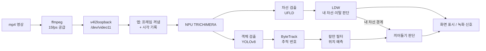

# 차선 이탈 경고(LDW)와 끼어들기 예측 경고

NextChip Apache6 SoM에서 블랙박스 영상을 NPU로 인식해, **내 차가 차선을 벗어나는 순간**과 **옆 차가 내 차선으로 끼어드는 순간**을 미리 알려 주는 기능이다.

| | 차선 이탈 경고 (LDW) | 끼어들기 예측 경고 (Cut-in) |
|---|---|---|
| 보는 대상 | **내 차**와 차선 | **다른 차**와 내 차선 |
| 핵심 질문 | 내 차가 곧 선에 닿는가? | 옆 차가 곧 내 차선 안으로 들어오는가? |
| 핵심 값 | 선까지 거리(m), 선에 닿기까지 남은 시간(TLC) | 차선 안 비율 u, 1초 뒤 예측 위치 |
| 알림 | 빨강(실선) / 노랑(점선) 테두리 + 문구 | 노란 이중 박스 + `CUT-IN WARNING` |
| 녹화 신호 | `nc_rec_trigger(0)` | `nc_rec_trigger(1)` |

---

## 1. 전체 구성



| 단계 | 내용 |
|---|---|
| 영상 입력 | 실제 카메라 대신 mp4를 ffmpeg로 가상 카메라 장치(v4l2loopback)에 15fps로 넣는다. 앱 입장에서는 카메라와 같다. |
| 시각 기록 | 앱이 프레임을 꺼내는 순간 `nc_get_mono_us_time()`을 기록하고, 이 값이 NPU 결과까지 따라간다. 객체와 차선 결과가 **어느 프레임에서 나온 것인지** 알 수 있다. |
| NPU | TRICHIMERA 모델 하나로 객체(차, 버스, 트럭 등), 도로 영역, 차선(4개)을 동시에 인식한다. |
| 추적·예측 | ByteTrack이 같은 차에 같은 번호를 붙이고, 칼만 필터가 차의 화면 속 위치와 속도를 추정한다. |
| 판단 | LDW가 내 차선 경계를 구하고, 끼어들기는 그 경계를 받아 판단한다. |
| 출력 | 1920x1080 화면에 결과를 그리고, 경고가 켜지는 순간 녹화 신호를 보낸다. 실제 속도는 약 15fps. |

---

## 2. 공통 개념

### 2-1. 차선 폭으로 픽셀을 미터로 바꾸기
카메라 내부 값(초점거리, 높이)을 모르는 상태에서 **차선 폭 3.5m**를 기준 자로 쓴다.

```
같은 높이(y)에서:  m/px = 3.5 m ÷ (오른쪽 선 x − 왼쪽 선 x)
```

원근 때문에 화면 아래로 갈수록 차선이 넓어진다. 높이마다 이 비율을 따로 구한다.

양쪽 선이 보일 때 `차선폭(px) = k·(y − 소실점 y)` 관계를 학습해 둔다. 그러면 한쪽 선만 보여도 반대쪽 선을 추정할 수 있다. 이 k로 카메라 높이도 구할 수 있다(`높이 = 3.5 ÷ k`, 시험 영상에서 약 1.27m).

### 2-2. 내 차선 영역
LDW가 계산한 좌우 경계를 다른 기능에 넘겨준다.

```c
int nc_ldw_get_ego_lane(ch, y, &x_left, &x_right, &time_us);   // 화면 높이 y에서 내 차선의 좌우 x
int nc_ldw_is_in_ego_lane(ch, x, y);                           // 그 점이 내 차선 안인가
```
끼어들기 판단은 이 함수로 "내 차선"을 정의한다.

### 2-3. 시간과 지연
- 모든 판단은 **프레임 개수가 아니라 실제 시간(ms)** 을 기준으로 한다. 앱 속도가 30fps가 아니라 약 15fps이고 상황에 따라 바뀌기 때문이다.
- 화면에 나온 결과는 이미 **지연시간**만큼 지난 결과다(측정값 약 35ms). LDW는 이 지연을 경고 기준에 더한다.

---

## 3. 차선 이탈 경고 (LDW)

### 3-1. 동작 원리

차선 모델이 새 결과를 낼 때마다 아래 순서로 계산한다.

| 단계 | 내용 |
|---|---|
| ① 직선 맞추기 | 내 차선 양쪽 선의 화면 아래쪽 점(y ≥ 594)으로 직선 `x = a·y + b`를 맞춘다. |
| ② 좌우 판단 | 측정선(y = 864, 보닛 바로 위)에서 **x 위치**로 왼쪽/오른쪽을 정한다. 모델의 슬롯 순서는 믿지 않는다. |
| ③ 미터 환산 | 측정선에서 `m/px = 3.5 ÷ 차선폭(px)` |
| ④ 선까지 거리 | 차 폭 1.85m 기준 **차 옆면에서 선까지 거리**. 가운데 있으면 양쪽 각 약 0.83m. |
| ⑤ 옆 이동 속도 | 차선 가운데에서 벗어난 정도의 변화 ÷ 시간. 지수평균(0.3)으로 흔들림을 줄인다. |
| ⑥ TLC | `선까지 거리 ÷ 그 선 쪽으로 움직이는 속도` (선에 닿기까지 남은 시간) |

**예외 처리**
- 차선을 실제로 넘으면 모델이 차선을 새로 잡아 위치가 차선 폭만큼 갑자기 바뀐다. 이것을 감지해 속도를 이어 붙이고 판단을 새로 시작한다.
- 차선이 0.5초 이상 안 보이면 "차선 없음"으로 보고 경고하지 않는다.

### 3-2. 경고 기준

왼쪽·오른쪽 **각각** 아래 둘 중 하나를 만족하면 경고 조건이다.

| 조건 | 기준 | 뜻 |
|---|---|---|
| **A. 가까움** | 선까지 **0.5m 미만**, 그 선에서 멀어지는 중이 아님 | 차가 가운데에서 약 0.33m 이상 치우침 |
| **B. 빠르게 다가감** | 그 선 쪽으로 이동 중이고 **TLC < 반응시간 0.8초 + 지연시간 + 여유 0.7초** (약 1.54초), 선까지 1.5m 미만 | 약 1.5초 안에 선에 닿을 것으로 예상 |

| 규칙 | 값 |
|---|---|
| 켜짐 | 조건이 **2번 연속** 만족 (순간적인 튐 무시) |
| 최소 유지 | **1초** |
| 양쪽 모두 해당 | 더 가까운 쪽 |

**경고 강도 (실선 / 점선)**

| 넘으려는 선 | 강도 | 이유 |
|---|---|---|
| 점선 | 약한 알림 (노랑) | 차선 변경이 허용되는 선 |
| 실선, 또는 판단 불가 | 강한 경고 (빨강) | 넘으면 안 되는 선 |

실선/점선 값(모델 출력 1 = 실선, 2 = 점선)은 프레임마다 흔들린다. 그래서 **최근 약 0.5초 투표**로 정한다.

### 3-3. 알림
- 항상: 노란 측정선, 흰 차 중심 표시, 왼쪽 위 `LDW L 0.8m R 0.8m v +0.0m/s TLC … (warn<1.5s, lat 35ms)`
- 강한 경고: 빨간 굵은 테두리 + `<<< LANE DEPARTURE LEFT`
- 약한 알림: 노란 얇은 테두리 + `<<< LEFT (dashed)`
- 녹화: 경고가 꺼짐 → 켜짐으로 바뀌는 순간 `nc_rec_trigger(0)` 1번

---

## 4. 끼어들기 예측 경고 (Cut-in)

### 4-1. 핵심 개념: 차선 안 비율 u

차의 위치를 화면 좌표가 아니라 **내 차선 안에서의 비율**로 나타낸다.

```
u = (차의 x − 왼쪽 선 x) ÷ (오른쪽 선 x − 왼쪽 선 x)      (같은 높이 y에서)

u < 0      : 왼쪽 차선     0 ≤ u ≤ 1 : 내 차선     u > 1 : 오른쪽 차선
```

곡선 도로나 내 차의 방향이 바뀌면 화면에서 차와 차선이 **같이** 밀린다. u는 둘의 비율이라 이 움직임이 상쇄되고, **실제로 옆으로 움직이는 차만** u가 바뀐다.

차의 기준점은 **박스 아래 가운데**(바퀴가 땅에 닿는 위치)를 쓴다.

### 4-2. 동작 원리

| 단계 | 내용 |
|---|---|
| ① 추적 | ByteTrack이 차·버스·트럭에 번호를 붙인다. 번호가 없는 객체는 제외한다. |
| ② 예측 | 차마다 **등속 칼만 필터**(상태: 화면 위치 x, y와 속도 vx, vy)를 돌린다. 프레임 사이 시간은 기록된 시각으로 계산한다. 측정이 3번 이상 쌓인 차만 예측한다. |
| ③ 지금 위치 | 마지막 측정 이후 화면 프레임까지의 시간만큼 앞당긴 박스 (최대 120ms) |
| ④ 미래 위치 | 지금 위치에서 **1초 뒤** 박스 아래 가운데 |
| ⑤ u 계산 | 지금과 1초 뒤의 u를 각자 그 높이의 내 차선 경계로 계산한다. |

### 4-3. 경고 기준

**후보 (한 프레임):**
```
지금 u < 0 또는 u > 1        (지금은 내 차선 밖)
그리고
1초 뒤 0.1 ≤ u ≤ 0.9         (1초 뒤엔 내 차선 안쪽으로 차선 폭의 10% 이상 들어옴)
```

| 규칙 | 값 | 이유 |
|---|---|---|
| 켜짐 | 후보가 **100ms 이상, 3프레임 이상** 연속 | 순간적인 박스 흔들림 무시 |
| 꺼짐 | 후보가 아닌 상태 **333ms** | 깜빡임 방지 |
| 최소 표시 | **1초** | 차 가운데가 선을 넘으면 바로 후보가 아니게 되어 경고가 너무 짧아짐 |
| 같은 차 중복 | **3초 안에 같은 자리**에서 다시 켜지면 녹화 다시 안 함 | 같은 차가 트럭↔승용차로 다시 인식되면 추적 번호가 새로 생김 |

**판단하지 않는 경우**

| 경우 | 기준 | 이유 |
|---|---|---|
| 먼 차 (`far`) | 그 높이의 차선 폭 **200px 미만** (약 17m 이상) | 멀수록 몇 px 오차로 u가 크게 틀어짐. 먼 버스 오경보를 없앰 |
| 차선 없음 (`lost`) | LDW에 그 높이의 차선이 없음 | 내 차선을 모름 |
| 오래된 차선 (`stale`) | 차선 결과가 200ms와 3프레임 간격 중 긴 쪽보다 오래됨 | 지난 차선으로 판단하지 않음 |
| 내 차선 변경 직후 | 화면 아래 차선 가운데가 차선 폭의 40% 이상 갑자기 이동하면 **0.5초** 쉼 | 내 차선 기준 자체가 바뀌는 순간 |

### 4-4. 알림
- 해당 차: **노란 이중 박스**, 라벨 `[번호]CUT-IN`
- 모든 차: 지금 위치 → 1초 뒤 위치를 잇는 **점선 예측선** (15px 미만이면 생략)
- 화면 아래: `CUT-IN WARNING`
- 녹화: 경고가 켜지는 순간 `nc_rec_trigger(1)` 1번 (같은 차 중복은 제외)

---

## 5. 두 기능의 관계

| 연결 | 내용 |
|---|---|
| 내 차선 | 끼어들기는 LDW의 `nc_ldw_get_ego_lane()`으로 내 차선을 정한다. LDW가 차선을 못 잡으면 끼어들기도 판단하지 않는다. |
| 시각 | 같은 시계(`nc_get_mono_us_time`)를 쓴다. LDW는 이동 속도, 끼어들기는 칼만 필터 시간 간격과 차선 결과 나이 판단에 쓴다. |
| 지연 | 서영 `nc_meas_get_latency_ms()`. LDW는 TLC 기준에 더하고, 끼어들기는 예측 상한(120ms)을 맞출 때 쓸 예정이다. |
| 모델 전환 | SKIP 모드(차선 결과 없음)에서는 LDW를 멈추고, 끼어들기도 내 차선이 없어 판단하지 않는다. |
| 녹화 | 경고 종류 번호로 구분한다 (0 = 차선 이탈, 1 = 끼어들기). |

---

## 6. 검증 결과

### 6-1. PC 가상 시험 (원근을 반영한 가상 차선·차)

| 상황 | 결과 |
|---|---|
| 6초에 걸쳐 천천히 끼어들기 | ✅ 경고 (예측 0.5초로는 놓쳐서 1초로 조정) |
| 2초에 빠르게 끼어들기 | ✅ 경고 |
| 옆 차선 유지, 앞차, 흔들림, 옆 차선 추월 | ✅ 오경보 0 |
| 30·20·14·10·7·5 fps | ✅ 모두 같은 동작 (시간 기준) |

### 6-2. 보드 (실제 영상, 최종 버전)

| 영상 | 장면 | 결과 |
|---|---|---|
| `test3_1080p.mkv` (국내 블랙박스) | 흰 차가 가까이서 끼어듦 (0~1.3초) | ✅ 반복 재생마다 약 1.2초에 경고, 1초 표시 |
| `px_5915075.mp4` (Pexels) | 은색 차가 천천히 끼어듦 (3~7초) | ✅ 약 3.7초 경고, 녹화 1번 |
| 같은 영상 9초 | 옆 차선 먼 버스 | ✅ 경고 없음 |
| `1920_1080_0001.mp4` (기본) | 끼어들기 없음, 오른쪽 선에 가까워짐 | ✅ 끼어들기 0, LDW는 선에 가까워진 3구간에서 경고 (실선 구간은 빨강, 점선 구간은 노랑) |

| 시스템 항목 | 결과 |
|---|---|
| 앱 속도 | 약 15fps (ByteTrack 포함) |
| 종료·재실행 | 영상 공급과 앱이 함께 정리되고, weston 유지 |
| 녹화 신호 | 경고 횟수 = 녹화 호출 횟수 |

---

## 7. 한계와 남은 과제

| 항목 | 내용 |
|---|---|
| 검증 영상 수 | 끼어들기는 실제 영상 2건(둘 다 오른쪽에서 진입)으로 확인했다. 왼쪽 진입, 정체 구간, 밤·비 영상 확인이 필요하다. |
| 먼 차 기준 200px | 버스 1건을 보고 정한 값이다. 가까운 끼어들기를 놓치지 않는지 더 확인해야 한다. |
| 카메라 위치 | LDW는 "화면 가운데 = 차 가운데"를 가정한다. 휴대폰처럼 다른 위치에서 찍은 영상은 오경보가 난다 (`cam_x_px` 조정 필요). |
| 앞차 거리 | 초점거리(화각)를 모르기 때문에 앞쪽 거리는 계산하지 않는다. 화각을 넣으면 `Z = f × 3.5 ÷ 차선폭(px)`로 구할 수 있다. |
| 예측 모델 | 화면 좌표의 등속 모델이라 1초가 넘으면 믿기 어렵고, 원근 때문에 다가오는 차는 오차가 생긴다. |
| 다른 기능 연결 | 지연 측정, 모델 전환, 녹화는 아직 서영 임시 함수로 연결되어 있다. |
| GPU 오류 | 실행마다 Mali 오류가 0~5건 나온다. 화면에 영향은 없고 원인은 미확인이다. |

---

## 부록 A. 주요 설정값

보드에서 다시 빌드하지 않고 환경변수로 바꿀 수 있다. 예: `CUTIN_MIN_LANE_W=150 ./run_app_wayland_npu.sh 영상`

| LDW | 기본 | 끼어들기 | 기본 |
|---|---|---|---|
| `LDW_WARN_MARGIN` | 0.5 m | `CUTIN_HORIZON_MS` | 1000 |
| `LDW_REACTION` / `LDW_TLC_MARGIN` | 0.8 / 0.7 s | `CUTIN_MARGIN` | 0.10 |
| `LDW_TLC_MAX_DIST` | 1.5 m | `CUTIN_ON_MS` / `CUTIN_OFF_MS` | 100 / 333 |
| `LDW_MIN_VEL` | 0.10 m/s | `CUTIN_MIN_ON_MS` | 1000 |
| `LDW_TRIGGER_FRAMES` | 2 | `CUTIN_DUP_MS` | 3000 |
| `LDW_HOLD` | 1.0 s | `CUTIN_MIN_LANE_W` | 200 px |
| `LDW_VEHICLE_WIDTH` | 1.85 m | `CUTIN_LANE_STALE_MS` | 200 |
| `LDW_REF_Y` / `LDW_CAM_X` | 864 / 960 px | `CUTIN_LC_HOLD_MS` | 500 |
| `LDW_DASHED_CLASS` | 2 | `CUTIN_POINT` | 0 (가운데) |

## 부록 B. 주요 파일

| 파트 | 파일 |
|---|---|
| LDW | `common/nc_app_modules/ldw/nc_ldw.c, nc_ldw.h` |
| 끼어들기 | `common/nc_app_modules/cnn/core/nc_cutin.c/h` (판단), `nc_traj.c/h` (칼만 예측), `nc_class.c/h` (차 종류) |
| 앱 연결 | `wayland_npu_app/wayland_npu_app.c`, `Makefile` |
| 영상 입력 | `misc/run_v4l2loopback.sh`, `misc/run_app_wayland_npu.sh`, `misc/run_app_common.sh`, `v4l2/v4l2_interface.c` |
| 시험 | `misc/ldw_board_check.sh`, 시험 영상 실행 방법은 `misc/image_npu/끼어들기_시험영상_실행방법.md` |

## 부록 C. 실행

```sh
cd /mnt/user_data/applications
./run_app_wayland_npu.sh                                   # 기본 영상 (LDW)
./run_app_wayland_npu.sh misc/image_npu/test3_1080p.mkv    # 끼어들기 영상
./ldw_board_check.sh 30 misc/image_npu/test3_1080p.mkv     # 결과 파일까지
```
